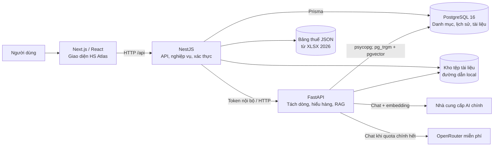
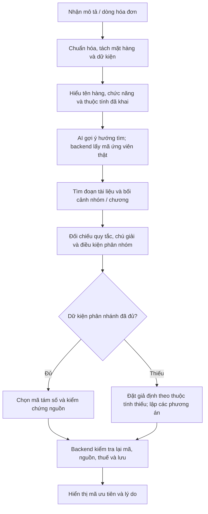

# Báo cáo kiến trúc hệ thống HS_Tool

**Phiên bản khảo sát:** 10/10/2026

**Phạm vi:** mã nguồn trong workspace `D:\HS_AI`

**Đối tượng đọc:** chủ dự án, lập trình viên tiếp quản, người vận hành
**Trạng thái:** mô tả hệ thống đang có; các hạng mục đề xuất được ghi riêng.

## 1. Tóm tắt

HS_Tool (giao diện HS Atlas) hỗ trợ đề xuất mã HS Việt Nam từ mô tả hàng hóa, giải thích căn cứ, đề xuất tên hàng khai báo và hiển thị thuế tham khảo. Hệ thống gồm giao diện Next.js, API NestJS, dịch vụ phân tích FastAPI, PostgreSQL và kho tệp tài liệu. Một lượt phân tích phải kết hợp dữ kiện hàng, danh mục mã HS và đoạn tài liệu có thể truy xuất; mã do mô hình ngôn ngữ gợi ý không tự trở thành kết luận.

Thiết kế hiện tại phục vụ ứng dụng web và xử lý từng mặt hàng. Với hóa đơn nhiều dòng, giao diện tách tối đa 10 mặt hàng trong một lượt chuẩn bị, cho xem và sửa từng mô tả, sau đó gọi phân tích cho từng hàng theo thứ tự. Mỗi hàng có kết quả, trạng thái lỗi và lịch sử riêng. Hệ thống có ba trạng thái nghiệp vụ: `COMPLETED`, `CONDITIONAL`, `INSUFFICIENT_EVIDENCE`. Sự cố nhà cung cấp AI được báo là lỗi dịch vụ thay vì ghi thành kết luận thiếu căn cứ.

### Nguyên tắc thiết kế

1. Hiểu đầy đủ tên và chức năng hàng hóa trước khi giả định thuộc tính còn thiếu.
2. Đi từ nhóm, phân nhóm đến nhánh tám chữ số thực có trong danh mục; xét điều kiện nhánh trước khi chọn đuôi “loại khác”.
3. Chỉ đặt giả định cho dữ kiện chưa khai và ghi rõ điều kiện của từng phương án.
4. Gắn nguồn trích dẫn, kiểm tra mã và nguồn ở cả dịch vụ AI lẫn backend.
5. Tra thuế theo đúng mã của từng phương án từ dữ liệu thuế đã nạp, giữ nguyên điều kiện áp dụng.

## 2. Kiến trúc tổng thể



Đây là ba tiến trình ứng dụng và một cơ sở dữ liệu chung. Backend chịu trách nhiệm xác thực, danh mục, lưu kết quả và kiểm tra nghiệp vụ cuối. AI service giữ logic xử lý văn bản, tìm tài liệu, hội thoại mô hình và phân tích mã. Frontend chỉ gọi API của backend; khóa AI và token nội bộ nằm ở tiến trình máy chủ. Dịch vụ AI giao tiếp với backend bằng `AI_SERVICE_TOKEN` trong header `x-service-token`.

| Thành phần | Công nghệ / cổng phát triển | Trách nhiệm chính | Vị trí mã |
| --- | --- | --- | --- |
| Giao diện | Next.js 15, React 19, TypeScript, Tailwind; `3000` | Nhập mô tả, chuẩn bị danh sách hàng, trình bày kết quả và quản trị | `frontend/app/`, `frontend/components/`, `frontend/lib/` |
| API nghiệp vụ | NestJS 11, Prisma 6; `3001/api` | Xác thực, tra danh mục, phối hợp phân tích, lưu lịch sử, thuế, quản trị | `backend/src/` |
| Dịch vụ AI | FastAPI, Python ≥ 3.11; `8000` nội bộ | Trích xuất, hiểu hàng, truy xuất căn cứ, phân loại, lập chỉ mục | `ai-service/app/` |
| Dữ liệu | PostgreSQL 16, `vector(1536)`, `pg_trgm` | Mã HS, tài liệu, đoạn văn, lịch sử, kết quả, phản hồi | `backend/prisma/schema.prisma` |
| Tệp và thuế | Đường dẫn local, JSON dựng từ workbook | Lưu tài liệu tải lên; tra thuế theo mã HS | `backend/src/documents/`, `backend/src/hs-codes/tariff-rates.json` |

**Ranh giới triển khai:** Docker Compose trong repo phục vụ PostgreSQL. Các ứng dụng được chạy bằng Node/Python; repo hiện chưa định nghĩa triển khai Kubernetes hay hàng đợi phân tán. Giao diện nhiều hàng xử lý tuần tự ở trình duyệt; chưa có thực thể “batch job” lưu bền trên server.

## 3. Chức năng và luồng người dùng

Người dùng có thể nhập tên hàng tiếng Việt hoặc tiếng Anh, dán nhiều dòng hóa đơn, hoặc trích xuất tệp mô tả. Với danh sách, bước `prepare-items` nhận văn bản tối đa 20.000 ký tự, cố gắng giữ nguyên dòng hàng, model, số lượng và đơn vị; các con số giá không được đưa thành thông số kỹ thuật. Giao diện cho người dùng xem/sửa từng dòng trước khi phân tích. Mỗi dòng đi qua API `classification/search` riêng, lưu ID riêng và hiển thị trong thẻ có thể thu gọn.

Kết quả của từng hàng gồm mã ưu tiên, lý do, trạng thái, các phương án có điều kiện, mã dễ nhầm, tên hàng khai báo đề xuất, thuế tham khảo và nguồn trích. Mẫu tên khai báo gom sáu nhóm thông tin: tên tiếng Việt; thành phần/chất liệu; công dụng/thông số; model/code; nhãn hiệu/xuất xứ; tình trạng. Thông tin chưa có được thể hiện là chưa khai hoặc điều kiện cần kiểm tra, không tự biến thành dữ kiện đã biết. Lịch sử tra cứu của người dùng đăng nhập và phản hồi đúng/sai được lưu trong backend.

## 4. Trình tự xác định mã HS



### 4.1. Hiểu hàng hóa trước khi suy luận

`product_understanding.py` và các module theo nhóm hàng chuẩn hóa cách gọi, nhận diện chức năng và dữ kiện hiện có. Các ràng buộc giữ thuộc tính đã khai, trích lời từ đầu vào và không đọc số model như công suất khi chưa có chứng cứ. Nhờ đó “inverter” được xét như máy biến đổi điện tĩnh; máy crochet được xét theo chức năng móc/đan thực, thay vì suy ra máy dệt kim phẳng từ tên chung. Với vật liệu đã khai rõ, hệ thống không thêm giả định vật liệu; với vật liệu thiếu, giả định chỉ xuất hiện ở phương án có điều kiện.

### 4.2. Danh mục và căn cứ

AI tạo từ khóa/mã gợi ý để tìm ứng viên, còn mã kết luận phải có trong `hs_codes` và còn hiệu lực hoạt động. Cấu trúc cha–con ở danh mục được lưu bằng `parent_code` dạng chuỗi; hệ thống giữ các nhánh tám số cùng một phân nhóm sáu số để kiểm tra công suất, kích thước, vật liệu hay công dụng. Đoạn pháp lý trong `document_chunks` được tìm bằng vector, độ giống từ khóa, ngữ cảnh chương/nhóm và khớp mã. Khi embedding không sẵn, đường truy xuất văn bản và bối cảnh pháp lý vẫn hoạt động. Nguồn dùng cho kết quả phải là ID đoạn tài liệu thực; tài liệu demo bị loại khỏi căn cứ phân loại thực.

### 4.3. Kết luận có điều kiện và kiểm tra lại

Khi dữ kiện có thể đổi mã chưa được cung cấp, `legalAnalysis.hypotheses` ghi mã, nhãn tình huống, giả định và giải thích riêng. Thứ tự phương án phản ánh cách hiểu hàng thông thường được ưu tiên trong mã hiện hành; không đồng nghĩa đã xác nhận thông số chưa khai. Khi nhánh hợp lệ bị bỏ sót, backend có thể đối chiếu danh mục và yêu cầu phân tích lại một lần. Backend tiếp tục lọc mã tám số, nguồn trích, trạng thái và thuế trước khi lưu. Nếu AI hoặc mạng lỗi, backend trả lỗi dịch vụ `503`, giữ ranh giới với `INSUFFICIENT_EVIDENCE` là khoảng trống căn cứ/danh mục.

| Trạng thái | Ý nghĩa trong giao diện | Hành động phù hợp |
| --- | --- | --- |
| `COMPLETED` | Có mã tám số được hỗ trợ, các thuộc tính ảnh hưởng nhánh đã đủ theo đầu vào | Đọc nguồn và xác nhận chứng từ trước khi khai |
| `CONDITIONAL` | Có một hoặc nhiều phương án mã theo dữ kiện chưa khai | Kiểm tra đúng giả định của phương án áp dụng |
| `INSUFFICIENT_EVIDENCE` | Chưa có mã hoặc căn cứ danh mục/tài liệu đủ hỗ trợ | Bổ sung nguồn, đối chiếu danh mục và chạy lại |

`confidence` là điểm xếp hạng nội bộ tính từ mức phù hợp ngữ nghĩa/từ khóa/mã, số nguồn và điểm mô hình. Nó không phải xác suất pháp lý rằng mã chắc chắn đúng.

## 5. Nạp và chuẩn hóa dữ liệu

### 5.1. Danh mục mã HS

`admin/hs-codes/import` nhận tệp bảng mã; AI service đọc XLSX, backend ghi vào `hs_codes`. Bộ nạp giữ nội dung mô tả của các dòng cấp trung gian không có mã riêng để gắn vào mã con. `scripts/refresh_catalog_descriptions.py` hỗ trợ khôi phục/bổ sung mô tả và tạo bản sao trước khi áp dụng. Dữ liệu danh mục cần được kiểm tra phiên bản, nguồn và hiệu lực; ứng dụng không tự xác nhận hiệu lực của tệp người dùng cung cấp.

### 5.2. Tài liệu pháp lý

Tài liệu được lưu ở `DOCUMENT_STORAGE_PATH`, khai báo trong `documents`, trích văn bản thành `document_chunks` với `page`, `chunk_index`, `search_text`, metadata và embedding tùy có. Các script `normalize_legal_corpus.py`, `audit_legal_corpus.py`, `import_legal_corpus.py` hỗ trợ chuẩn hóa, kiểm tra và nạp bộ tài liệu lớn. Tài liệu trạng thái `READY` mới được tra cứu. Chỉ mục ngữ nghĩa dùng vector 1.536 chiều; worker lưu theo đợt và tiếp tục sau giới hạn quota. Đừng xem chỉ mục đã hoàn tất nếu báo cáo kiểm tra còn `remaining_embeddings > 0`.

### 5.3. Thuế

`scripts/build_tariff_rates.py` tạo `backend/src/hs-codes/tariff-rates.json` từ workbook thuế 2026. Backend tra **đúng mã tám số** cho từng kết luận/tình huống, trả các cột như thuế thông thường, MFN, VAT và các FTA cùng vị trí dòng nguồn. Ô có điều kiện hoặc nhiều mức vẫn được giữ nguyên; ứng dụng không tự kết luận hàng đã đủ điều kiện ưu đãi FTA. JSON thuế là bản dữ liệu nạp, cần cập nhật theo kỳ và đối chiếu văn bản hiện hành.

## 6. Mô hình dữ liệu

`backend/prisma/schema.prisma` định nghĩa tám bảng nghiệp vụ chính cùng quan hệ:

| Bảng | Dữ liệu và quan hệ chính |
| --- | --- |
| `users` | Email duy nhất, mật khẩu băm, vai trò `USER`/`ADMIN`; một người có nhiều lượt tra cứu. |
| `hs_codes` | Mã duy nhất, mô tả, cấp mã, `parent_code`, khoảng hiệu lực, trạng thái và nguồn. `parent_code` là chuỗi logic, không có khóa ngoại tự tham chiếu. |
| `documents` | Tiêu đề, loại, nguồn, phiên bản, ngày hiệu lực khai báo, đường dẫn, trạng thái `PROCESSING`/`READY`/`FAILED`. |
| `document_chunks` | Văn bản, văn bản tìm kiếm, trang, thứ tự, metadata JSON, embedding `vector(1536)`; thuộc một tài liệu. |
| `classification_searches` | Đầu vào gốc, hàng chuẩn hóa JSON, phân tích pháp lý JSON, trạng thái, thông tin còn thiếu, người dùng tùy chọn. |
| `classification_results` | Mã HS, mô tả, điểm, giải thích và thứ hạng; thuộc một lượt tra cứu. |
| `classification_sources` | Nối kết quả với tài liệu, đoạn trích, trang và điểm liên quan. |
| `feedback` | Đúng/sai, mã sửa, bình luận, liên kết lượt tra cứu và có thể liên kết kết quả. |

Tài liệu và đoạn trích có liên kết khóa ngoại; xóa tài liệu kéo theo đoạn trích theo schema. Phần phân tích chi tiết là JSON trong lượt tra cứu, cho phép chứa câu hỏi quyết định, giả định và phương án mà không phải tạo bảng riêng cho từng dạng hàng. Hệ quả là cần kiểm thử schema JSON ở lớp ứng dụng khi nâng phiên bản.

## 7. Giao diện, API và phân quyền

Các tuyến backend dưới `/api`:

| Nhóm | Tuyến chính | Vai trò |
| --- | --- | --- |
| Xác thực | `POST /auth/register`, `POST /auth/login`, `GET /auth/me` | Tạo tài khoản, đăng nhập, xác định người dùng. |
| Phân tích | `POST /classification/prepare-items`, `/extract`, `/search`; `GET /classification/:id`, `/history`; `POST /classification/:id/feedback` | Tách hàng, trích tệp, phân tích, xem lại và phản hồi. |
| Danh mục | `GET /hs-codes/search`, `GET /hs-codes/:code` | Tìm kiếm và xem mã. |
| Quản trị | `/admin/dashboard`, `/documents`, `/hs-codes`, `/feedback`, `/history`, `/low-confidence`, `/users` | Nạp/duyệt dữ liệu, phân quyền và giám sát. |

Backend áp dụng validation, CORS theo `FRONTEND_ORIGIN`, Helmet, JWT và guard người dùng/quản trị. Route phân tích có giới hạn theo người dùng/IP ở một tiến trình; nếu nhân bản backend, giới hạn cần chuyển sang kho dùng chung. Frontend lưu token phiên trong `sessionStorage`, vì vậy cần bảo vệ giao diện khỏi XSS. Tệp tải lên được giới hạn kích thước và kiểm tra đường dẫn/định dạng ở luồng xử lý.

## 8. Nhà cung cấp AI và giới hạn quota

`AI_PROVIDER` chọn nhà cung cấp chính; adapter hiện có cho Gemini REST và API tương thích OpenAI. Khi chat chính bị HTTP 429 và `AI_FALLBACK_PROVIDER=openrouter`, AI service chuyển các bước chat của lượt phân tích sang OpenRouter. Adapter chỉ nhận tuyến `openrouter/free` hoặc model `:free` có bảng giá xác thực bằng 0, yêu cầu JSON và áp giới hạn giá bằng 0 cho request. DeepSeek là adapter chat dự phòng cũ nếu được chọn riêng. **Embedding luôn dùng nhà cung cấp chính**; OpenRouter/DeepSeek trong cấu hình này không tạo embedding. Khi embedding hết quota, tra cứu từ khóa/bối cảnh vẫn dùng được, còn worker chờ rồi tiếp tục tạo vector.

Biến môi trường quan trọng (chỉ lưu tên biến trong tài liệu): `DATABASE_URL`, `AI_PROVIDER`, `AI_API_KEY`, `AI_BASE_URL`, `AI_CHAT_MODEL`, `AI_EMBEDDING_MODEL`, `AI_EMBEDDING_DIMENSIONS`, `AI_FALLBACK_PROVIDER`, `OPENROUTER_API_KEY`, `AI_SERVICE_URL`, `AI_SERVICE_TOKEN`, `JWT_SECRET`, `DOCUMENT_STORAGE_PATH`, `NEXT_PUBLIC_API_URL`, `FRONTEND_ORIGIN`. Không đặt khóa bí mật vào biến `NEXT_PUBLIC_*`, Git hay tài liệu công khai.

## 9. Cách xây dựng và chạy hệ thống

### 9.1. Chuẩn bị môi trường mới

Yêu cầu: Node.js ≥ 22, pnpm 11, Python ≥ 3.11, PostgreSQL 16 có `vector` và `pg_trgm`. Có thể khởi chạy PostgreSQL local bằng `docker compose up -d postgres`. Tạo `.env` từ `.env.example` **chỉ khi chưa có `.env`**, rồi điền khóa/token/database riêng. Sao lưu DB và kho tệp trước khi thay dữ liệu hiện có.

```powershell
pnpm install
python -m pip install -r ai-service/requirements.txt
pnpm --dir backend prisma:generate
pnpm --dir backend db:deploy
pnpm dev
```

`pnpm dev` gọi `scripts/start.ps1` để khởi động, kiểm tra sẵn sàng và tái sử dụng worker lập chỉ mục nếu đang chạy. Nếu chạy riêng, dùng `python ai-service/run.py`, `pnpm dev:backend`, `pnpm dev:frontend` ở các cửa sổ tiến trình tương ứng. Các lệnh trên giả định `DATABASE_URL` đã được nạp cho Prisma; chi tiết PowerShell nạp biến nằm trong `README.md`. Lệnh seed (`pnpm --dir backend db:seed`) chỉ phù hợp dữ liệu demo hoặc khi chủ động tạo tài khoản quản trị mới với cấu hình tương ứng.

### 9.2. Nạp dữ liệu trước khi dùng

1. Chạy migration và kiểm tra các extension cơ sở dữ liệu.
2. Nạp bảng mã HS qua trang quản trị hoặc API; kiểm tra mã tám số, mô tả nhánh, nguồn và trạng thái.
3. Nạp tài liệu nguồn; chờ trạng thái `READY`, kiểm tra số đoạn và trích dẫn.
4. Chạy chuẩn hóa/kiểm tra corpus; theo dõi `remaining_embeddings`. Có thể phân tích bằng truy xuất từ khóa trong lúc vector chưa đầy đủ.
5. Dựng và kiểm tra JSON thuế từ workbook đã xác minh; đối chiếu vài mã theo dòng nguồn.
6. Gọi `/health` và `/ready` của AI service (route `/ready` cần token nội bộ), sau đó thử phân loại qua API backend.

### 9.3. Đóng gói và vận hành

`pnpm build` dựng backend và frontend. Chạy backend bằng `pnpm --dir backend start:prod`, frontend bằng `pnpm --dir frontend start`, AI service bằng quy trình Python riêng. Khi triển khai thực tế cần HTTPS tại reverse proxy, chỉ cho backend truy cập AI service, lưu bí mật ngoài mã nguồn, sao lưu đồng bộ PostgreSQL và kho tài liệu, theo dõi dung lượng/quota/log và duy trì một worker chỉ mục chủ động. Repo chưa cung cấp cấu hình hạ tầng sản xuất đầy đủ; các bước vận hành này là khuyến nghị triển khai.

## 10. Kiểm thử và bằng chứng hiện có

| Phạm vi | Kết quả đã ghi nhận trong dự án | Tệp tham chiếu |
| --- | --- | --- |
| Kiểm thử hồi quy | 243 ca Python, 51 ca backend, 14 ca frontend đạt ở lượt kiểm tra trước; build TypeScript/backend đạt. Đây là kết quả tại thời điểm ghi nhận, cần chạy lại khi mã thay đổi. | `ai-service/tests/`, `backend/src/**/*.spec.ts`, `frontend/tests/` |
| Hóa đơn 10 dòng | API tách 10 sản phẩm thành 10 ID; mỗi dòng được phân tích/lưu riêng, giao diện dựng 10 thẻ. Bốn inverter ưu tiên 85044090 theo giả định; sáu servo còn điều kiện công suất. | `.logs/verified-ten-invoice/` (chỉ lưu máy cục bộ) |
| Giấy trang trí phủ PU | Mẫu đủ dữ kiện trả `COMPLETED`, mã 48119099 và không thêm giả định. | `.logs/verified-paper-live/` (chỉ lưu máy cục bộ) |
| Crochet, điện, van, quà tặng | Bộ kiểm thử mô tả và luồng phân tích kiểm tra các lỗi đã từng tái hiện. | `docs/CLASSIFICATION_FLOW_AUDIT.md` |

Các kết quả trên chứng minh những trường hợp đã thử, không bảo đảm mọi mã HS hoặc mức thuế đều đúng. Chưa có xác nhận trực quan bằng trình duyệt tự động cho mọi màn hình. Các kết quả `CONDITIONAL` của động cơ servo không nên công bố như mã đã chốt khi công suất chưa được khai.

## 11. Rủi ro vận hành và giới hạn

| Vấn đề hiện tại | Hệ quả | Hướng xử lý |
| --- | --- | --- |
| Chỉ mục vector phụ thuộc quota embedding của nhà cung cấp chính | Truy xuất ngữ nghĩa có thể chưa phủ hết tài liệu; hệ thống chuyển sang từ khóa | Theo dõi `remaining_embeddings`, giữ worker tiếp tục theo quota, đánh giá mức phủ |
| Tài liệu do người dùng cung cấp chưa được kiểm định hiệu lực tự động | Trích dẫn có thể cần đối chiếu văn bản hiện hành | Lưu phiên bản, ngày hiệu lực, nguồn chính thức và quy trình duyệt |
| Bảng thuế là ảnh chụp dữ liệu workbook 2026 | Có thể lạc hậu hoặc cần điều kiện FTA/VAT riêng | Cập nhật định kỳ, đối chiếu mức và điều kiện với nguồn gốc |
| Nhiều hàng được điều phối tại trình duyệt | Mất phiên trình duyệt có thể ngắt lượt đang chạy; không có hàng đợi server | Thêm batch job lưu bền nếu khối lượng tăng |
| Kho tệp local, rate limit trong một tiến trình | Khó nhân bản ngang và phục hồi máy chủ | Chuyển sang object storage và bộ đếm dùng chung khi mở rộng |
| JWT trong `sessionStorage` | Cần kiểm soát XSS chặt | Đánh giá cookie HttpOnly/SameSite và chính sách CSP |

## 12. Lộ trình đề xuất

Các hạng mục dưới đây **chưa được triển khai**; thứ tự ưu tiên dựa trên rủi ro vận hành và tính đúng đắn:

1. **Quản trị nguồn:** lưu phiên bản biểu thuế, hiệu lực từng văn bản và quy trình duyệt để chứng minh nguồn áp dụng tại thời điểm phân loại.
2. **Đánh giá chất lượng:** xây bộ mẫu có đáp án theo ngành hàng, gồm đầu vào ngắn/đủ dữ kiện, mã dễ nhầm, tình huống nhiều hàng và phép thử không được suy diễn thông số model. Đo độ đúng theo nhóm hàng và trạng thái, không chỉ đếm test.
3. **Vận hành chỉ mục:** theo dõi tiến độ, retry có trạng thái, thay thế văn bản theo phiên bản và báo cáo mức phủ tìm kiếm.
4. **Batch phía máy chủ:** lưu batch, từng item và tiến độ vào DB; hàng đợi công việc giúp tiếp tục sau khi đóng trình duyệt.
5. **Mở rộng hệ thống:** object storage, rate limit dùng chung, dashboard lỗi/độ trễ/quota, backup và phục hồi định kỳ.

## 13. Tệp tham chiếu trong repo

- Kiến trúc API và schema: [`backend/src/module.ts`](../backend/src/module.ts), [`backend/src/classification/classification.ts`](../backend/src/classification/classification.ts), [`backend/prisma/schema.prisma`](../backend/prisma/schema.prisma).
- Dịch vụ AI và truy xuất: [`ai-service/app/main.py`](../ai-service/app/main.py), [`ai-service/app/rag.py`](../ai-service/app/rag.py), [`ai-service/app/product_understanding.py`](../ai-service/app/product_understanding.py), [`ai-service/app/product_batch.py`](../ai-service/app/product_batch.py), [`ai-service/app/ai_client.py`](../ai-service/app/ai_client.py).
- Giao diện: [`frontend/app/page.tsx`](../frontend/app/page.tsx), [`frontend/components/classification-batch.tsx`](../frontend/components/classification-batch.tsx), [`frontend/lib/classification-batch.ts`](../frontend/lib/classification-batch.ts).
- Triển khai/dữ liệu: [`README.md`](../README.md), [`.env.example`](../.env.example), [`scripts/start.ps1`](../scripts/start.ps1), [`docs/AI_SETUP.md`](AI_SETUP.md), [`docs/CLASSIFICATION_FLOW_AUDIT.md`](CLASSIFICATION_FLOW_AUDIT.md).

> Ghi chú: báo cáo mô tả mã nguồn tại thời điểm khảo sát, không phải ý kiến xác nhận mã HS hay hiệu lực của tài liệu pháp lý. Việc khai hải quan cần đối chiếu chứng từ hàng thực và quy định đang áp dụng.
